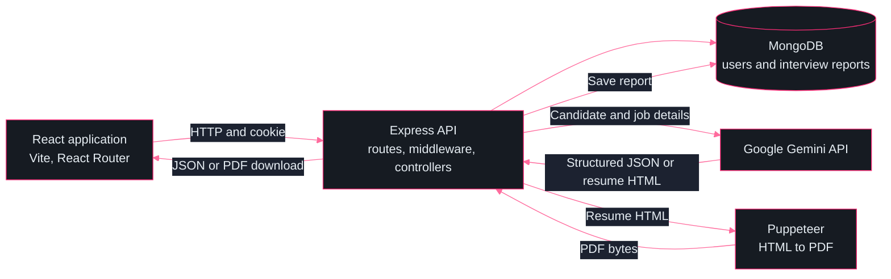
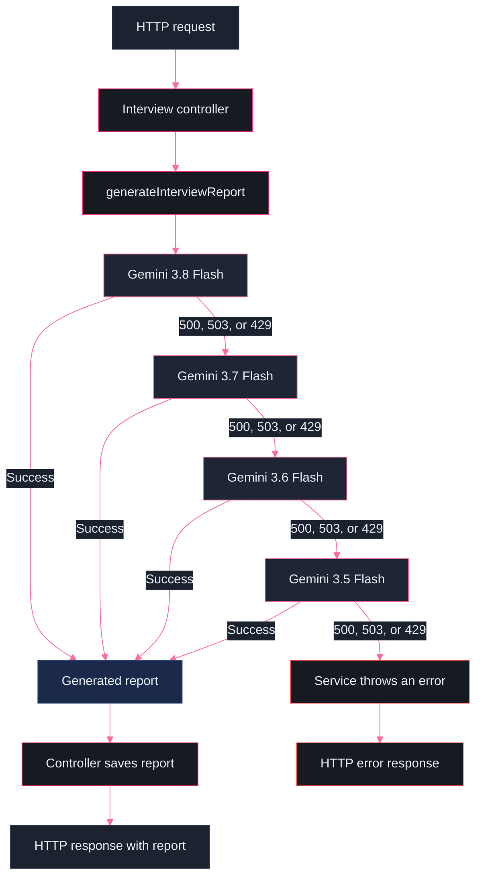
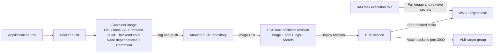
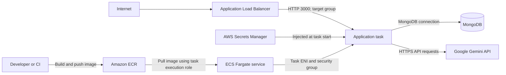

# Interview.ai

Interview.ai is a web app for preparing for job interviews. A signed-in user provides a target job description and their resume/profile, then the app uses Google Gemini to build a personalized interview report. The report includes a match score, technical and behavioral questions, answer guidance, skill gaps, and a preparation roadmap. From a report, the user can also generate and download an AI-tailored resume as a PDF.

## Contents

- [Features](#features)
- [Tech stack](#tech-stack)
- [NPM packages](#npm-packages)
- [Architecture](#architecture)
- [Interview report flow](#interview-report-flow)
- [Resume PDF flow](#resume-pdf-flow)
- [Data model](#data-model)
- [API routes](#api-routes)
- [Run locally](#run-locally)
- [Deploy to AWS with Docker, ECR, and ECS](#deploy-to-aws-with-docker-ecr-and-ecs)
- [Environment variables](#environment-variables)
- [Project structure](#project-structure)

## Features

- Register and log in with a username, email, and password.
- Keep a signed-in session with a JWT cookie and log out by invalidating the token.
- Submit job and candidate information to generate an AI interview report.
- Review technical and behavioral questions, their intent, and suggested answers.
- Review a role match score, skill gaps, and a day-by-day preparation plan.
- Reopen recent reports saved to the signed-in user's account.
- Generate and download a tailored resume PDF.
- Use public About, Help, Privacy Policy, and Terms pages.
- Responsive dark-themed interface.

## Tech stack

<p>
  
  
  
  
  
  
  
</p>

The frontend is built with React, Vite, React Router, and Sass. The backend uses Node.js, Express, MongoDB with Mongoose, and Google's Gemini API. Puppeteer renders AI-generated resume HTML as PDF.

## NPM packages

Install packages separately in `Backend/` and `Frontend/`; each folder has its own `package.json` and lockfile.

### Backend runtime packages

| Package | Role |
| --- | --- |
| `express` | HTTP server and API routing |
| `mongoose` | MongoDB models and database access |
| `@google/genai` | Gemini API client for interview reports and resume HTML |
| `zod`, `zod-to-json-schema` | Define AI response shapes and convert schemas for Gemini |
| `multer` | Receive resume files in memory |
| `pdf-parse` | Extract text from uploaded PDF resumes |
| `puppeteer` | Render generated resume HTML to PDF |
| `jsonwebtoken`, `bcryptjs` | Sign login tokens and hash passwords |
| `cookie-parser`, `cors` | Parse session cookies and configure cross-origin requests |
| `dotenv` | Load local environment variables |

### Frontend runtime packages

| Package | Role |
| --- | --- |
| `react`, `react-dom` | UI components and browser rendering |
| `react-router` | Client-side navigation and routes |
| `axios` | HTTP requests to the backend API |
| `sass` | SCSS compilation and styling |

### Development packages

The frontend uses `vite` and `@vitejs/plugin-react` for development and builds, plus `eslint`, `eslint-plugin-react-hooks`, `eslint-plugin-react-refresh`, `@eslint/js`, `globals`, `@types/react`, and `@types/react-dom` for linting and editor/type support. The backend's `dev` script runs `nodemon` through `npx`.

## Architecture

The repository has a React/Vite frontend and an Express/MongoDB backend. The frontend calls the backend over HTTP. Protected API calls send the authentication cookie using Axios `withCredentials`.



### Frontend

- `Frontend/src/main.jsx` starts React and imports global styles.
- `Frontend/src/App.jsx` provides the shared auth and interview contexts and the router.
- `Frontend/src/app.routes.jsx` defines the login, register, protected home/report, and public information pages.
- `Frontend/src/features/auth` contains auth state, API calls, forms, protected-route handling, and logout.
- `Frontend/src/features/interview` contains the home form, report display, interview API, report context, and page styles.
- `Frontend/src/components/LoadingState.jsx` provides the themed loading UI.

### Backend

The backend starts in `Backend/server.js`. It loads environment variables, connects to MongoDB, and starts the Express app on port `3000` by default (or the port in `PORT`). `Backend/src/app.js` installs JSON, cookie, and CORS middleware, serves the built frontend from `Backend/public`, then mounts the route modules.

Requests generally pass through these layers:

1. A route matches the HTTP method and path.
2. Protected routes run `auth.middleware.js` to validate the JWT cookie and check the token blacklist.
3. A controller handles request data and persistence.
4. A service performs work such as calling Gemini or rendering a PDF.
5. A Mongoose model reads or writes MongoDB data.

## Interview report flow

1. The user fills in a job description and profile information on the home page and selects **Generate My Interview Plan**.
2. The frontend submits a `multipart/form-data` request containing `jobDescription`, `selfDescription`, and an optional `resume` file to `POST /api/interview/`. The user must provide a job description and either a resume or a self-description.
3. The route checks the user's JWT cookie and passes an uploaded file through Multer when one is present. Multer keeps the file in memory and limits it to 3 MB.
4. When a resume PDF is attached, the interview controller extracts its text with `pdf-parse`; without a file, it proceeds using the self-description.
5. `ai.service.js` combines the available candidate information and job description into a Gemini prompt. Missing resume or self-description values are marked as not provided, and the prompt tells Gemini not to invent candidate qualifications or experience.
6. The service requests JSON output using a schema derived from Zod. It parses Gemini's response as JSON; the response is not separately validated with `interviewReportSchema.parse()`. The expected result contains:
   - `title` and `matchScore`
   - `technicalQuestions` and `behavioralQuestions`, each with a question, intention, and answer guidance
   - `skillGaps` with a low, medium, or high severity
   - `preparationPlan` with a day, focus, and tasks
7. The service tries these report model names in order: `gemini-3.8-flash`, `gemini-3.7-flash`, `gemini-3.6-flash`, then `gemini-3.5-flash`. For API errors with status `500`, `503`, or `429`, it tries the next name; other errors are rethrown immediately. These names reflect the current source configuration and may need updating to models enabled for your API key.
8. The controller saves the report and its source text in MongoDB, associated with the current user, and returns the created report.
9. The frontend navigates to `/interview/:interviewId`. The report page fetches the saved report and displays the sections, score, and skill gaps.

### Gemini model fallback flow

The report service tries configured Gemini models in sequence. If a request fails with status `500`, `503`, or `429`, it tries the next model. Other errors stop the sequence and are returned to Express. If every configured model fails with a retryable status, the service throws an error for the API request.



## Resume PDF flow

The **Download Resume** button generates a tailored resume PDF from the source information saved with an interview report. It does not download the interview report itself.

1. The frontend sends `POST /api/interview/resume/pdf/:interviewReportId` with the session cookie.
2. The backend loads the saved resume text, self-description, and job description for that report.
3. `generateResumePdf()` asks `gemini-3-flash-preview` for a JSON response with one `html` field. Its prompt requests a concise, professional, ATS-friendly resume tailored to the role.
4. The backend parses the JSON response and gives the HTML to Puppeteer.
5. Puppeteer creates a browser page, sets the generated HTML as its content, and renders an A4 PDF with 10 mm margins.
6. The API responds with `application/pdf` bytes and an attachment filename. The frontend receives a Blob and starts a browser download.

## Data model

### User

The `users` collection stores a unique username, unique email, and bcrypt-hashed password. Login returns a JWT in a cookie; the JWT expires after one day. Logout adds the current token to the `blacklistTokens` collection and clears the cookie.

### Interview report

The `InterviewReport` collection stores:

- The owning user and generated job title.
- The job description, extracted resume text, and self-description.
- The match score, technical and behavioral questions, skill gaps, and preparation plan.
- `createdAt` and `updatedAt` timestamps.

The report-list API omits source text and detailed report sections to keep the recent-reports response smaller. A single-report request returns the full report.

## API routes

In the deployed single-container setup, the frontend and API share the same origin. When running locally, the backend origin is `http://localhost:3000`. Routes marked **Protected** require the JWT cookie.

| Method | Path | Access | Purpose |
| --- | --- | --- | --- |
| `POST` | `/api/auth/register` | Public | Create a user account. Request JSON: `username`, `email`, `password`. |
| `POST` | `/api/auth/login` | Public | Verify credentials and set the JWT cookie. Request JSON: `email`, `password`. |
| `GET` | `/api/auth/logout` | Public | Blacklist the current token and clear its cookie. |
| `GET` | `/api/auth/get-me` | Protected | Return the current user's basic details. |
| `POST` | `/api/interview/` | Protected | Generate and save a report from multipart fields `jobDescription`, optional `selfDescription`, and optional `resume` (at least one candidate source is required). |
| `GET` | `/api/interview/` | Protected | List the current user's recent reports. |
| `GET` | `/api/interview/report/:interviewId` | Protected | Fetch one report owned by the current user. |
| `POST` | `/api/interview/resume/pdf/:interviewReportId` | Protected | Generate and download a tailored resume PDF. |

## Run locally

You need Node.js/npm and a reachable MongoDB database. The backend and frontend run in separate terminals.

### 1. Configure the backend

Create `Backend/.env` and set the variables described in [Environment variables](#environment-variables). Keep this file private and do not commit it.

```powershell
cd Backend
npm install
npm run dev
```

The backend listens on `http://localhost:3000`. Its `dev` script runs `npx nodemon server.js`; if nodemon is not available, run `node server.js`.

### 2. Start the frontend

In another terminal:

```powershell
cd Frontend
npm install
npm run dev
```

Vite serves the app at `http://localhost:5173` by default. The backend CORS configuration currently allows that origin.

### 3. Build or lint the frontend

```powershell
cd Frontend
npm run build
npm run lint
```

`npm test` in the backend is currently a placeholder and does not run a test suite.

## Deploy to AWS with Docker, ECR, and ECS

This deployment uses one Docker image for the complete application: the frontend is built with Vite, then copied into the backend image, where Express serves it alongside the API. The image includes the Node.js base operating system, application code, Node.js dependencies, and Chromium required by Puppeteer. Amazon ECR stores the image; Amazon ECS on Fargate runs it without managing EC2 hosts. An Application Load Balancer (ALB) provides the public entry point.

### Deployment workflow

The diagrams below show the release steps and how requests flow through the deployed AWS resources.





### 1. Prepare AWS resources and application configuration

Choose an AWS Region and create or select a VPC with at least two Availability Zones. Place the ALB in public subnets and the Fargate tasks in private subnets. Configure private-subnet outbound access through a NAT gateway (or another approved egress path), because the application must connect to MongoDB and the Gemini API. If using MongoDB Atlas IP access lists, allow the NAT gateway's static public IP rather than task IP addresses.

Create an AWS Secrets Manager secret containing the application's production values. For example, the secret can be a JSON object with `MONGO_URI`, `JWT_SECRET`, and `GOOGLE_GENAI_API_KEY`. Restrict access to the secret and do not put credentials in the Docker image, source control, or a plain-text task-definition environment variable. If the secret uses a customer-managed KMS key, the task execution role also needs permission to decrypt with that key.

### 2. Create an ECR repository and push the Docker image

The repository's Dockerfile is named `dockerfile` (lowercase), so specify it with `-f`. Run these commands from the repository root in PowerShell with Docker and the AWS CLI installed and configured for an identity allowed to create/use the ECR repository and push images:

> **Note:** The root `.gitignore` currently excludes `dockerfile`. It must be present in the build workspace for `docker build` to work. Keep a copy in your local workspace, or intentionally include it in the repository/build pipeline if deployments need to build from a fresh checkout.

```powershell
$AWS_REGION = "us-east-1"
$AWS_ACCOUNT_ID = "123456789012"
$ECR_REPOSITORY = "interview-ai"
$IMAGE_TAG = "1.0.0"
$REGISTRY = "$AWS_ACCOUNT_ID.dkr.ecr.$AWS_REGION.amazonaws.com"

aws ecr create-repository --repository-name $ECR_REPOSITORY --region $AWS_REGION
aws ecr get-login-password --region $AWS_REGION |
    docker login --username AWS --password-stdin $REGISTRY

docker build -f dockerfile -t "${ECR_REPOSITORY}:${IMAGE_TAG}" .
docker tag "${ECR_REPOSITORY}:${IMAGE_TAG}" "${REGISTRY}/${ECR_REPOSITORY}:${IMAGE_TAG}"
docker push "${REGISTRY}/${ECR_REPOSITORY}:${IMAGE_TAG}"
```

Replace the sample account, region, and image tag with your own values. Use a unique tag for each release; avoid relying on `latest` for production rollbacks. ECR image tags are references to the built image, not a substitute for deploying a new ECS task definition.

### 3. Create the ECS task execution role and task definition

In IAM, create or use the ECS task execution role trusted by `ecs-tasks.amazonaws.com`. Attach the standard `AmazonECSTaskExecutionRolePolicy` so ECS can pull from ECR and publish container logs to CloudWatch Logs. Add narrowly scoped `secretsmanager:GetSecretValue` permission for the application secret (and `kms:Decrypt` only if required by its customer-managed key).

Create an ECS cluster with the AWS Fargate capacity provider, then register a Fargate task definition with settings like these:

| Setting | Value |
| --- | --- |
| Operating system / architecture | Linux / X86_64 |
| Network mode | `awsvpc` |
| Task size | Start with 1 vCPU and 2 GiB memory; adjust using CloudWatch metrics and load testing. |
| Task execution role | The role described above; used by ECS to pull the image, write logs, and retrieve configured secrets. |
| Task role | No AWS permissions are needed by the current application code. Add permissions only if the application later calls AWS services directly. |
| Container image | `<account-id>.dkr.ecr.<region>.amazonaws.com/interview-ai:<image-tag>` |
| Container port | `3000` / TCP |
| Environment | `PORT=3000`; `PUPPETEER_EXECUTABLE_PATH=/usr/bin/chromium` |
| Secrets | Map `MONGO_URI`, `JWT_SECRET`, and `GOOGLE_GENAI_API_KEY` from Secrets Manager. |
| Logs | Use the `awslogs` driver and a dedicated CloudWatch Logs group with retention configured. |

The Dockerfile sets `PUPPETEER_EXECUTABLE_PATH`; setting it explicitly in the task definition makes the runtime requirement visible. ECS injects the configured Secrets Manager values when the task starts. Grant the execution role access to the secret; do not grant broad access to all secrets.

### 4. Configure the load balancer and security groups

Create an internet-facing Application Load Balancer across at least two public subnets and an IP target group on HTTP port `3000`. Configure the target group's health check path as `/`; the app serves the built frontend at this path. Set the success matcher to `200`.

Use separate security groups with least-privilege rules:

| Security group | Inbound | Outbound |
| --- | --- | --- |
| ALB security group | Allow HTTPS `443` from intended client networks (or `0.0.0.0/0` for a public site). Optionally allow HTTP `80` only to redirect to HTTPS. | Allow TCP `3000` to the ECS task security group. |
| ECS task security group | Allow TCP `3000` only from the ALB security group. Do not expose the task directly to the internet. | Allow required connections to MongoDB, Gemini, and AWS endpoints/NAT. |

Request or import an ACM certificate in the ALB's Region. Set the ALB's `443` listener to forward to the target group and, if port `80` is enabled, redirect it to HTTPS. Add a DNS record pointing your application domain to the ALB. Ensure the MongoDB network/access-list configuration permits connections from the tasks' egress path.

### 5. Create and deploy the ECS service

Create an ECS service from the task definition in the cluster. Select Fargate, deploy tasks into the private subnets, disable public IP assignment, and associate the service with the ALB target group and container port `3000`. Choose a desired task count appropriate for the app and enable the ECS deployment circuit breaker with rollback where available. Wait until the tasks are `RUNNING` and the ALB target group reports healthy targets, then open the ALB DNS name or configured domain over HTTPS.

For later releases, build and push a new uniquely tagged image, update the task definition to use that tag, and update the ECS service to deploy the new revision. Monitor ECS service events, container logs in CloudWatch, target health, CPU/memory, and MongoDB/Gemini connectivity. Keep the previous task-definition revision and image available for rollback.

### Production checklist

- Store production credentials in Secrets Manager and use scoped IAM roles. The developer/CI identity that pushes images should have only the ECR permissions it needs; it should not use the ECS task role.
- Keep ECS tasks in private subnets and allow application ingress only from the ALB security group. Do not expose MongoDB to `0.0.0.0/0`.
- The current CORS configuration allows `http://localhost:5173`. The single-origin deployment serves the frontend and API from the same origin, so browser API calls do not require cross-origin access. If deploying the frontend on a different origin, configure CORS for that exact trusted origin.
- The current login code sets the JWT cookie without explicit production cookie options. Before exposing the app publicly, configure the cookie with appropriate `httpOnly`, `secure` (HTTPS), and `sameSite` settings, and verify login/logout behavior through the ALB.
- Configure log retention, alarms, backups for MongoDB, TLS renewal/ownership, and a tested rollback procedure before production use.

## Environment variables

Set these in `Backend/.env`:

| Variable | Purpose |
| --- | --- |
| `MONGO_URI` | MongoDB connection string. |
| `JWT_SECRET` | Secret used to sign and verify login tokens. Use a long, random value. |
| `GOOGLE_GENAI_API_KEY` | API key used by `@google/genai` to call Gemini. |

Example shape (replace each placeholder locally; do not commit real credentials):

```dotenv
MONGO_URI=mongodb://127.0.0.1:27017/interview-ai
JWT_SECRET=replace-with-a-long-random-secret
GOOGLE_GENAI_API_KEY=your-google-genai-api-key
```

## Project structure

```text
.
├── Backend/
│   ├── server.js
│   └── src/
│       ├── app.js
│       ├── config/          # MongoDB connection
│       ├── controllers/     # Auth and interview request handlers
│       ├── middlewares/     # JWT authorization and file upload
│       ├── models/          # User, report, and blacklisted-token schemas
│       ├── routes/          # Express route definitions
│       └── services/        # Gemini report and PDF generation
└── Frontend/
    ├── index.html
    └── src/
        ├── app.routes.jsx
        ├── App.jsx
        ├── components/
        └── features/
            ├── auth/
            └── interview/
```
